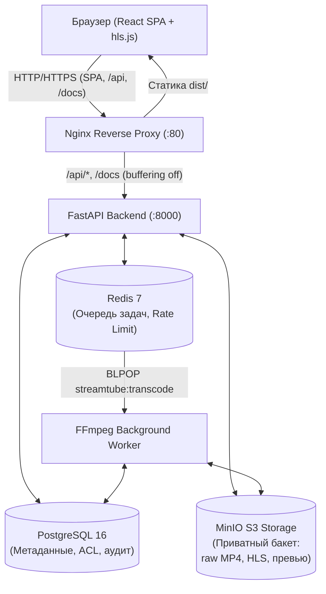

# Архитектура системы (StreamTube)

## Обзор

StreamTube построен по слоистой сервисно-ориентированной архитектуре с чётким разделением **control plane** (метаданные, права доступа, социальный граф в PostgreSQL) и **media data plane** (хранение бинарных объектов в S3/MinIO, фоновая обработка в FFmpeg-воркере, авторизованная раздача HLS и HTTP Range через FastAPI).

## Видео-пайплайн (сердце системы)

### 1. Загрузка (Ingestion)
- Запрос `POST /api/v1/videos` принимает `multipart/form-data` (видео + опциональное превью + метаданные).
- Nginx настроен с `client_max_body_size 520M` и `proxy_request_buffering off` для потоковой передачи.
- FastAPI читает поток чанками по `1 MiB` во временный файл, контролируя лимит размера и проверяя **magic bytes** первых 32 байт контейнера (ISO BMFF `ftyp`, EBML/WebM, RIFF/AVI, Ogg).
- Исходный файл сохраняется в объектное хранилище под UUID-ключом `videos/{video_id}/source.{ext}` (пользовательское имя файла никогда не попадает в пути хранилища).
- В таблицу `videos` записывается статус `processing`, а `video_id` ставится в очередь Redis (`RPUSH streamtube:transcode`).

### 2. Фоновая обработка (`app/worker/transcoder.py`)
- Независимый контейнер `worker` читает задачи из Redis (`BLPOP`).
- Скачивает исходник в изолированный `TemporaryDirectory`.
- Запускает `ffprobe` (`shell=False`, `-protocol_whitelist file,pipe`, timeout 30s) для валидации видеопотока и извлечения `duration_seconds`, `width`, `height`.
- Если пользователь не загрузил кастомное превью, извлекает кадр в JPEG (`videos/{video_id}/thumb.jpg`).
- Транскодирует видео в **HLS** (`master.m3u8`, `stream_0.m3u8`, сегменты `seg_%03d.ts` по 4 секунды, H.264/AAC, до 720p, `-preset veryfast`) и загружает артефакты в `videos/{video_id}/hls/`.
- Обновляет запись в PostgreSQL: `hls_master_key`, `thumbnail_key`, `duration_seconds`, `status = 'ready'`.

### 3. Раздача и Zero-Trust проксирование (`app/api/v1/media.py`)
- **MinIO бакет полностью закрыт** и не доступен напрямую извне.
- При открытии видео `GET /api/v1/videos/{id}` проверяет политику `can_view_video()` и выдаёт короткоживущий HMAC-SHA256 `playback_token` (15 минут), привязанный к `(video_id, user_id, exp)`.
- **HLS-доставка (`/api/v1/media/{id}/hls/{filename}`):** при отдаче `.m3u8` сервер динамически переписывает относительные ссылки на дочерние плейлисты и `.ts`-сегменты, добавляя `?token=...`. Это позволяет стандартному `hls.js` безопасно воспроизводить приватные видео без утечки учётных данных.
- **Мгновенный фоллбэк (`/api/v1/media/{id}/stream`):** поддерживает стандартные HTTP-заголовки `Range: bytes=start-end` (`206 Partial Content`) напрямую из S3/MinIO, поэтому видео можно смотреть сразу после загрузки, не дожидаясь окончания транскодирования.

## Абстракция хранилища (`app/storage/`)
- Интерфейс `StorageBackend` имеет две реализации:
  - `S3Storage` (boto3 + MinIO/AWS S3) — используется в production/Docker.
  - `LocalStorage` (файловая система с проверкой path traversal) — используется в локальной разработке и автотестах `pytest` без внешних зависимостей.
