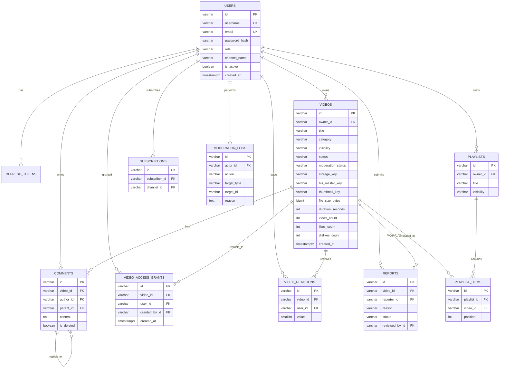

# Проектирование базы данных (PostgreSQL)

## Разделение данных: что и где хранится

| Хранилище | Данные | Обоснование |
| :--- | :--- | :--- |
| **PostgreSQL 16** | Пользователи, роли, refresh-токены, метаданные видео, ACL приватного доступа, реакции, комментарии, подписки, плейлисты, жалобы, журнал аудита | ACID-транзакции, реляционная целостность (`FK`, `UNIQUE`, `CHECK`), быстрые выборки по составным индексам |
| **MinIO (S3)** | Исходные видеофайлы (`source.*`), HLS-плейлисты (`.m3u8`), видео-сегменты (`.ts`), превью (`.jpg/.png/.webp`) | Горизонтально масштабируемое объектное хранилище, byte-range чтение, не раздувает БД |
| **Redis 7** | Очередь транскодирования (`streamtube:transcode`), счётчики rate-limiting | Низкая задержка, атомарные операции `BLPOP` и скользящего окна `ZSET` |

## ER-диаграмма

## Ключевые проектные решения

1. **Индексирование ленты:** составной индекс `ix_videos_feed (visibility, moderation_status, created_at)` ускоряет основной запрос главной страницы, отсекая приватные и скрытые видео на уровне индекса.
2. **Строгая целостность на уровне СУБД:**
   - `uq_video_access_grant (video_id, user_id)` — исключает дублирование прав доступа.
   - `uq_video_reaction (video_id, user_id)` + `CHECK (value IN (1, -1))` — гарантирует одну реакцию пользователя на видео.
   - `uq_subscription_pair (subscriber_id, channel_id)` + `CHECK (subscriber_id != channel_id)` — запрещает дубли и подписку на самого себя.
   - `uq_playlist_video (playlist_id, video_id)` — исключает дубли видео в плейлисте.
   - Каскадное удаление (`ON DELETE CASCADE`) очищает зависимые сущности без «висячих» записей, а для аудита и модерации используется `ON DELETE SET NULL` на `actor_id` / `reviewed_by_id`, чтобы история модерации сохранялась.
3. **Денормализованные счётчики (`likes_count`, `dislikes_count`, `views_count`):** хранятся в `videos` для быстрого рендера карточек ленты и пересчитываются/инкрементируются атомарно при изменении реакций и просмотров.
4. **Миграции:** схема версионируется через **Alembic** (`backend/migrations/versions/0001_initial_schema.py`).
